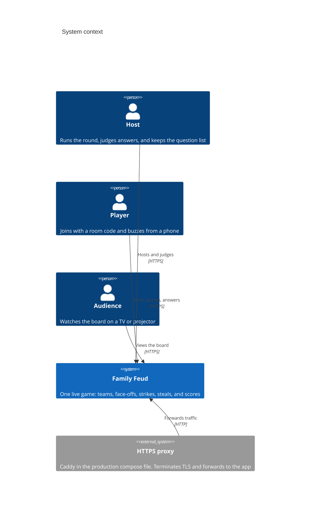
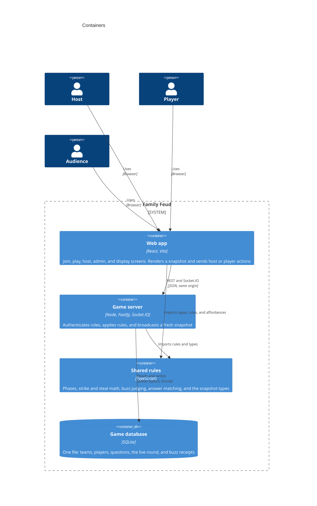
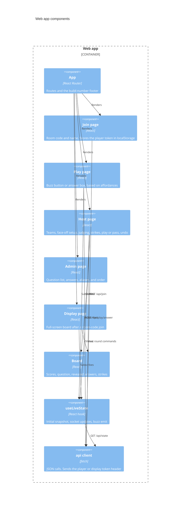
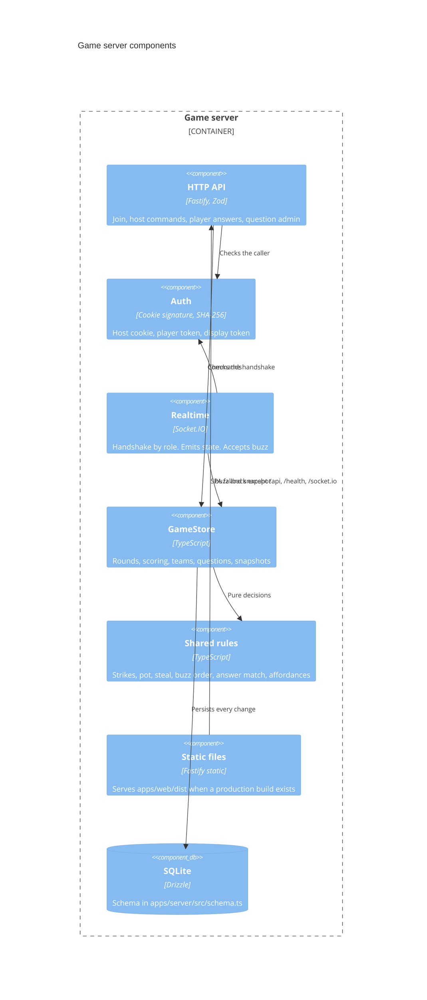

# Architecture

Family Feud is a browser party game for one room. A host runs the round, players buzz and answer from their phones, and a display screen shows the board. The server owns the rules and the scores. Every client renders a snapshot of that state.

This document uses the [C4 model](https://c4model.com/): system context, containers, and components. Diagrams use [Mermaid C4 syntax](https://mermaid.js.org/syntax/c4.html).

## System context

People in the room use one deployed game. There is no account system and no external game service. The only outside dependency in production is the reverse proxy that terminates HTTPS.

## Containers

The repository is a pnpm workspace with three packages. In production they collapse into one Node process: Fastify serves the built React app, the HTTP API, and Socket.IO. SQLite is a file on disk, not a separate service.

In development, Vite serves the web app on port 5173 and proxies `/api`, `/health`, and `/socket.io` to the server on port 3000. `pnpm dev` starts both.

| Package | Path | Role |
| --- | --- | --- |
| `@feud/web` | `apps/web` | React client |
| `@feud/server` | `apps/server` | Fastify process and `GameStore` |
| `@feud/shared` | `packages/shared` | Code imported by both sides |

Production packaging is `deploy/Dockerfile` plus `deploy/docker-compose.yml`. The image builds the web app, then starts the server. Compose puts Caddy in front and mounts the SQLite file from `data/`.

## Components

### Web app

Each route is a page. Live pages share one hook that loads `/api/state` and then listens for `state` on a socket. The board is the only shared visual component. The build number in the footer comes from the root `package.json` `version` field, injected by Vite.

Routes:

| Path | Who | What they do |
| --- | --- | --- |
| `/` | Player | Join the room |
| `/play` | Player | Buzz or submit an answer |
| `/host` | Host | Run the game |
| `/admin` | Host | Edit questions |
| `/display` | Audience | Show the board |

### Game server

`createApp` in `apps/server/src/app.ts` wires HTTP, cookies, sockets, and static files. `GameStore` in `apps/server/src/game.ts` is the only writer of game state. After a successful mutation it broadcasts a new snapshot to every socket. The snapshot is built for that socket's role, so a player never receives the answer key.

HTTP is for commands that carry a body. The socket is for the live snapshot and the buzz, which must be ordered by arrival on the server.

Round phases, in order, live in `packages/shared`:

1. `faceoff` — host opens the buzzer for the two chosen players.
2. `faceoffAnswer` — the buzz winner, or the other player after a miss, submits a guess.
3. `faceoffChoice` — the winning team plays or passes.
4. `play` — one player at a time on the controlling team answers. Three strikes end the turn.
5. `steal` — the other team gets one guess.
6. `roundEnd` — points are on the score. The host can reveal the rest and start the next round.

## Architecture decisions

### AD-1. One room, one process

The product is a party in a single room, not a multi-tenant service. One Fastify process holds the live game, and one SQLite file holds history for that installation. Compose does not run a database container.

Consequence: two servers would split buzz order and broadcasts. Scaling out is a new design, not a config change.

### AD-2. The server is the source of truth

Clients do not advance the round. They send an intent and render the next snapshot. Host, player, and display sockets each get a snapshot shaped for that role.

The host snapshot includes the unrevealed answer key, the pending guess, the fuzzy-match suggestion, and the room code. Player and display snapshots include revealed board rows only. Hidden text and points are null.

### AD-3. Shared package for rules that both sides must agree on

`packages/shared` holds the snapshot types, strike and steal math, buzz eligibility, answer normalization, and `playerAffordances`. The server applies the rules. The play page uses the same affordance function so the buzz button and the answer box match what the server will accept.

The web Vite config aliases `@feud/shared` to the TypeScript source so the client does not need a separate build of the package.

### AD-4. SQLite through Drizzle, with synchronous writes

`better-sqlite3` keeps each command and its broadcast on one thread. Buzz receipts, the winner of a window, and score updates commit before other sockets are told. There is no migration framework in the repo: `apps/server/src/schema.ts` is the table list, and `db.ts` opens and seeds the file.

Player and display tokens are stored as SHA-256 hashes. The raw token stays in the browser.

### AD-5. Three credentials, three roles

| Role | How they prove it | Storage |
| --- | --- | --- |
| Host | Password compared in constant time, then a signed `host_session` cookie | HTTP-only cookie. `SESSION_SECRET` signs it. `Secure` only when `NODE_ENV` is production |
| Player | Room code plus a unique name | `x-player-token` header and socket auth token |
| Display | Room code | `x-display-token` header and socket auth token |

`HOST_PASSWORD`, `ROOM_CODE`, and `SESSION_SECRET` are required at startup. The room code can later be changed from the host screen and is then read from the database.

Host routes reject a missing cookie. A player can submit an answer only when `GameStore` says that player is the current answerer.

### AD-6. Buzzes are ordered by server receipt

Face-off buzzes are the only client message on the socket (`buzz`). The server records eligible players for that window and keeps the first accepted receipt. Later buzzes on a closed or already-won window are ignored. Client clocks are not compared.

During main play and a steal there is no buzz. The host picks whose phone may answer.

### AD-7. The host judges wording

A submitted string is stored as pending. `matchAnswer` can report an exact answer or a nearby suggestion. Nothing hits the board until the host accepts a specific answer, forces a row, or rejects the guess. A reject in the face-off passes the turn or reopens the buzzer. A reject or strike in main play counts toward three strikes. A miss on the steal awards the pot to the team that had control.

Undo restores the last captured round snapshot.

### AD-8. One snapshot channel

Mutations call `broadcast`, which emits `state` to each connected socket. There is no per-field patch. A reconnect loads `GET /api/state` and then follows the socket. That keeps the board, the host console, and the phones on the same round without a second read model.

### AD-9. Development proxy, production static files

Vite proxies API and socket traffic so the dev UI can stay on port 5173. The production server looks for `apps/web/dist` and, when it exists, serves it and falls back to `index.html` for client routes. API, health, and socket paths are not rewritten.

`GET /health` is the compose healthcheck.

### AD-10. The build number is a single integer

The root `package.json` `version` is a whole number. `pnpm dev` displays it and does not change it. `apps/web` `build` runs `scripts/bump-version.mjs` before Vite, then embeds the new value as `__APP_VERSION__`. The footer on every route shows that number.

The counter only keeps climbing across builds if the updated `package.json` is committed. A Docker build bumps the copy inside the image and does not write back to git.

## Runtime configuration

| Variable | Required | Purpose |
| --- | --- | --- |
| `HOST_PASSWORD` | Yes | Host login |
| `ROOM_CODE` | Yes | Seeded room code |
| `SESSION_SECRET` | Yes | Host cookie signature |
| `DATABASE_PATH` | No | SQLite path. Default `data/feud.sqlite` under the repo root |
| `PORT` | No | Listen port. Default 3000 |
| `NODE_ENV` | No | `production` turns on the secure host cookie |
| `DOMAIN` | Compose | Caddy site name |
